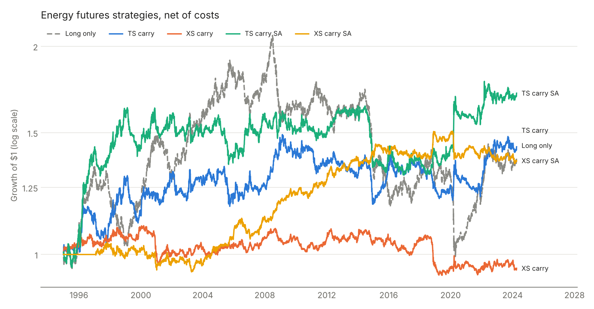
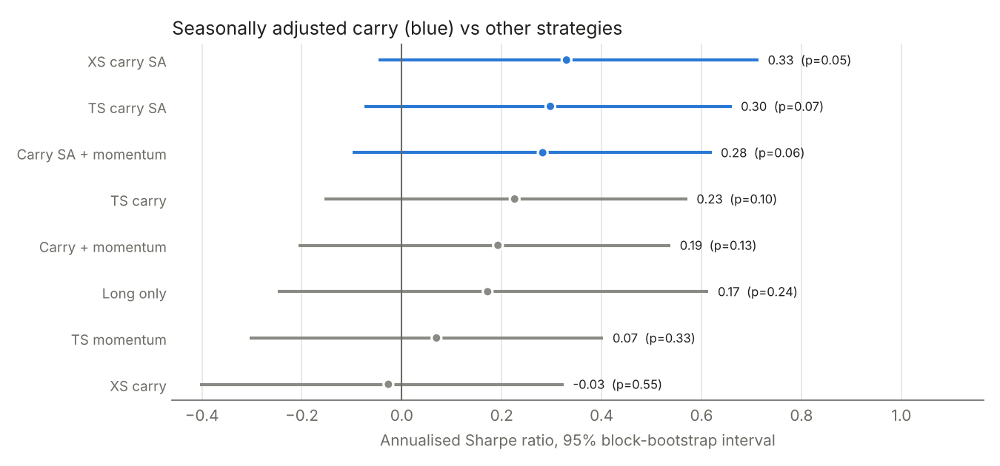
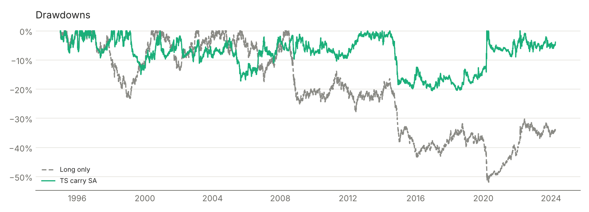

# Energy Futures Carry

[](https://github.com/yasminebenabdelkrim3-source/energy-futures-carry/actions/workflows/ci.yml)

**Does the shape of the futures curve predict returns in energy markets?**
This project tests whether *carry* (the roll yield implied by backwardation or
contango) earns a risk premium across NYMEX energy futures, how it interacts
with time-series momentum, and how robust the result is across regimes:
the 2008 crash, the 2014–16 oil glut, negative WTI in April 2020, and the
2022 energy crisis.

> Status: data pipeline, signals, backtest, risk analytics and robustness tests
> are in place. See [Results](#results) and the [Roadmap](#roadmap).

---

## Universe and data

| Key           | Contract                          | Unit       | Last trading day rule                         |
|---------------|-----------------------------------|------------|-----------------------------------------------|
| `wti`         | WTI Crude Oil (CL)                | USD/bbl    | 3 bdays before the 25th of the prior month    |
| `natgas`      | Henry Hub Natural Gas (NG)        | USD/MMBtu  | 3 bdays before the 1st of the delivery month  |
| `rbob`        | RBOB Gasoline (RB)                | USD/gal    | last bday of the prior month                  |
| `heating_oil` | NY Harbor ULSD / Heating Oil (HO) | USD/gal    | last bday of the prior month                  |

Daily settlement prices for contracts 1 to 4 come from the
[EIA open-data API](https://www.eia.gov/opendata/) (free key). Business days
are inferred from the data, so exchange holidays need no separate calendar.

| Key           | Sample                  | Trading days |
|---------------|-------------------------|-------------:|
| `wti`         | 1985-01-02 → 2024-04-05 | 9,865 |
| `natgas`      | 1994-01-13 → 2024-04-05 | 7,591 |
| `rbob`        | 2005-10-03 → 2024-04-05 | 4,651 |
| `heating_oil` | 1994-02-02 → 2024-04-05 | 7,566 |

EIA stopped publishing NYMEX futures prices after 5 April 2024, so the sample
ends there.

## Methodology

### 1. From "contract 1" labels to tradable returns
EIA's *contract 1* is a label: the day after expiry, the old contract 2 becomes
contract 1. `c1.pct_change()` therefore mixes two contracts on roll days and
creates fake jumps equal to the calendar spread. That bias is large for natural gas.

`efc.data.continuous.rolled_returns` simulates a position that holds the front
contract, **rolls to the second contract N trading days before expiry**, and
measures every daily return on the *same physical contract*. The position never
holds a contract on its last trading day, which also avoids the delivery
squeeze of 20 April 2020 (WTI at −37 USD/bbl).

### 2. Checking the calendar against the data
Exchange rules have changed over time. For example, Henry Hub contracts
expired 6 business days before delivery in the mid-1990s, versus 3 today.
`efc.data.roll_detection` therefore checks every expiry against the prices.
On the day after an expiry, each label moves down one contract. Today's
c1..c3 then line up with yesterday's c2..c4, not with yesterday's c1..c3:

$$
\text{score}_t=\frac{\operatorname{std}_r\big(\ln c_{r,t}-\ln c_{r,t-1}\big)}{\operatorname{std}_r\big(\ln c_{r,t}-\ln c_{r+1,t-1}\big)}
$$

The common market move cancels out of both terms, so the test still works on
volatile days. Each expiry is labelled *confirmed*, *inconclusive* (flat curve)
or *misaligned*. `refine_expiries` moves an expiry only when the data are
unambiguous.

| Commodity   | Confirmed | Inconclusive | Misaligned (rule) | Misaligned (refined) |
|-------------|----------:|-------------:|------------------:|---------------------:|
| WTI         | 387 | 65 | 19 | 0 |
| Natural gas | 296 | 34 | 33 | 0 |
| RBOB        | 207 | 11 |  4 | 0 |
| Heating oil | 291 | 56 | 15 | 0 |

Most natural gas corrections fall in 1994–1997, matching the older expiry rule.
The largest remaining daily moves are real events (17 Jan 1991, 20–21 Apr 2020,
Mar 2022), not roll artefacts.

### 3. Carry signal
$$
\text{carry}_t = \frac{12}{m}\,\ln\frac{F^{\text{near}}_t}{F^{\text{far}}_t}
$$
Positive carry means backwardation and negative carry means contango. Inside the
roll window the signal uses the c2/c3 spread, i.e. the contract actually held.

### 4. Portfolio construction and evaluation
Directions in [−1, 1] come from the sign of carry and of 12-1 momentum, or from
cross-sectional carry ranks. Each asset is scaled to the same ex-ante
volatility (60-day EWMA), with leverage capped and monthly rebalancing.
Weights set at the close of day *t* earn the returns of day *t+1*. Costs are
charged on every rebalance and every roll. Evaluation covers Sharpe, Sortino,
drawdowns, historical VaR/ES, Sharpe by sub-period, block-bootstrap confidence
intervals and one-parameter-at-a-time sensitivity.

## Results

Settings were fixed in advance from the literature, with nothing tuned on this
data: monthly rebalancing, 10% ex-ante volatility per asset (60-day EWMA),
leverage capped at 2x per asset, roll 5 trading days before expiry, 12-1 month
momentum, 21-day smoothed carry, and **5 bps per side** on every rebalance and
every roll. Sample: 1995-01 to 2024-04.

"SA" means *seasonally adjusted* carry. Natural gas, gasoline and heating oil
curves have a predictable seasonal shape (winter gas, summer gasoline). For
each calendar month, we subtract the average seasonal deviation of carry
estimated on **past years only**, so what remains is this year's
supply/demand signal.



| Strategy | Sharpe | Ann. return | Ann. vol | Max DD | ES 99% (1d) | Bootstrap 95% CI | p-value |
|---|---:|---:|---:|---:|---:|:---:|---:|
| Long only (equal risk) | 0.17 | 1.1% | 8.4% | −52.1% | 1.9% | [−0.25, 0.61] | 0.24 |
| TS carry | 0.23 | 1.2% | 6.3% | −20.6% | 1.5% | [−0.16, 0.57] | 0.10 |
| XS carry | −0.03 | −0.2% | 3.5% | −15.2% | 0.8% | [−0.40, 0.32] | 0.55 |
| TS momentum | 0.07 | 0.2% | 7.4% | −37.6% | 1.6% | [−0.31, 0.40] | 0.33 |
| Carry + momentum | 0.19 | 0.9% | 5.7% | −21.0% | 1.4% | [−0.21, 0.54] | 0.13 |
| **TS carry SA** | **0.30** | 1.9% | 7.0% | −20.5% | 1.7% | [−0.08, 0.66] | 0.07 |
| **XS carry SA** | **0.33** | 1.1% | 3.4% | −10.2% | 0.8% | [−0.05, 0.71] | 0.05 |
| Carry SA + momentum | 0.28 | 1.6% | 6.4% | −20.8% | 1.6% | [−0.10, 0.62] | 0.06 |

Full tables: [`reports/results.md`](reports/results.md) (performance, sub-periods)
and [`reports/robustness.md`](reports/robustness.md) (bootstrap, split sample,
sensitivity).





### What we can and cannot conclude
- **Carry predicts energy futures returns, and seasonal adjustment matters.**
  Removing the seasonal shape improves every carry strategy. The biggest change
  is cross-sectional carry, from −0.03 to 0.33. Without adjustment, the ranking
  mostly says "short gas", a seasonal bet rather than a carry bet.
- **The effect is consistent but small.** TS and XS SA carry are positive in
  both halves of the sample (Sharpe 0.40–0.42 in 1995–2009, 0.17–0.24 in
  2010–2024). They survive every roll timing tested (1 to 10 days) and costs
  up to 10 bps per side.
- **It is not proven.** Bootstrap p-values are 0.05–0.07 and every 95% interval
  still includes zero. Eight strategies were compared, and the seasonal
  adjustment was added *after* seeing the cross-sectional result. Both inflate
  the odds of a false positive.
- **Cross-sectional SA carry is fragile to smoothing.** Its Sharpe is 0.08 with
  no smoothing, −0.02 with 5 days, and 0.33–0.40 with 21–63 days.
  Time-series SA carry is more stable (0.17–0.30).
- **Momentum adds little on energy alone.** Holding energy long has a −52%
  drawdown, versus about −20% for the carry strategies.

**Bottom line:** in this small universe, carry is a plausible but statistically
fragile premium. The honest next step is out-of-sample evidence: more
commodities, or data after April 2024.

## Quick start

```bash
git clone https://github.com/yasminebenabdelkrim3-source/energy-futures-carry
cd energy-futures-carry
python -m venv .venv && source .venv/bin/activate   # Windows: .venv\Scripts\activate
pip install -e ".[dev]"

cp .env.example .env        # then paste your free EIA API key
python scripts/download_data.py
python scripts/run_backtest.py     # writes reports/results.md and figures
python scripts/run_robustness.py   # bootstrap + sensitivity -> reports/robustness.md
pytest
```

```python
from efc.config import COMMODITIES
from efc.data import expiry_dates, held_rank, load_prices, refine_expiries, rolled_returns
from efc.signals import carry_for_held

px = load_prices("wti")
exp = refine_expiries(px, expiry_dates(px.index, COMMODITIES["wti"].expiry_rule))
ret = rolled_returns(px, exp, roll_days=5)
carry = carry_for_held(px, held_rank(px.index, exp, roll_days=5))
```

## Project layout

```
src/efc/
  config.py            commodity universe, EIA series ids, expiry rules
  data/eia.py          EIA API client with pagination + local CSV cache
  data/calendar.py     last-trading-day rules per contract
  data/continuous.py   rolled front-month returns
  data/roll_detection.py  data-driven check and refinement of the expiry calendar
  signals/carry.py     annualised carry from the term structure
  signals/momentum.py  time-series momentum (12-1)
  portfolio.py         panel building, EWMA vol, position sizing, strategies
  backtest.py          no-look-ahead engine with rebalance and roll costs
  metrics.py           Sharpe, Sortino, drawdowns, VaR / ES, sub-periods
  robustness.py        block-bootstrap Sharpe confidence intervals and p-values
scripts/download_data.py
scripts/run_backtest.py
scripts/run_robustness.py
reports/               results table and figures
tests/                 unit tests on a synthetic market with known ground truth
```

## Roadmap
- [x] Data pipeline (EIA, cache, expiry calendar, rolled returns)
- [x] Data-driven validation of the expiry calendar
- [x] Carry signal
- [x] Momentum signals and signal combination
- [x] Backtest engine (vol targeting, transaction costs, no look-ahead)
- [x] Risk and performance analytics (Sharpe, drawdown, VaR/ES, turnover)
- [x] Seasonally adjusted carry for natural gas and refined products
- [x] Statistical significance: block bootstrap of Sharpe ratios
- [x] Robustness: roll-day, cost, smoothing and lookback sensitivity, split sample
- [ ] Out-of-sample: extend the universe (Brent, metals, agriculture) or the sample past 2024
- [ ] Multiple-testing correction (e.g. deflated Sharpe ratio)
- [ ] Research notebook and write-up of findings

## Limitations
- The sample ends on 5 April 2024, when EIA stopped publishing futures prices.
  Extending it would need another data source.
- EIA publishes only 4 contracts, so carry is measured on the 1-to-2 month
  spread. The seasonal adjustment uses past averages and cannot catch a seasonal
  pattern that changes over time.
- Seasonally adjusted signals need 3 years of history, so they start trading in 1997.
- The universe is small (4 energy contracts). Cross-sectional results should be
  read with that in mind.
- Settlement prices only: no intraday data and no bid/ask. Costs are modelled
  as a fixed fee per roll and per rebalance.

## References
- Koijen, Moskowitz, Pedersen & Vrugt (2018), *Carry*, Journal of Financial Economics.
- Moskowitz, Ooi & Pedersen (2012), *Time Series Momentum*, Journal of Financial Economics.
- Erb & Harvey (2006), *The Strategic and Tactical Value of Commodity Futures*, Financial Analysts Journal.

---
*Research project for educational purposes. Not investment advice.*
